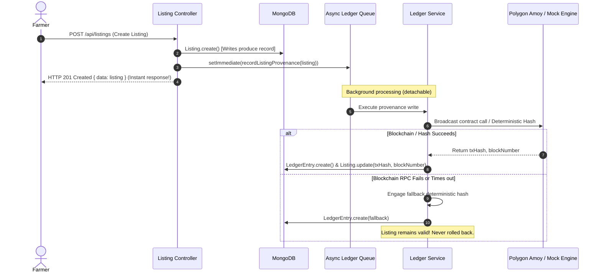

# 07 — Blockchain Provenance Ledger Architecture

## 1. Overview & Objectives

In direct-from-farm marketplaces, consumers and commercial buyers (restaurants, hotels, retailers) demand authentic proof of harvest origin. Middlemen historically obscure provenance, misrepresent conventional produce as organic, or sell cold-stored surplus as "freshly picked today."

The **Blockchain Provenance Ledger** provides tamper-proof, decentralized verification of agricultural produce batches:
1. **Farm-Gate Certification**: When a farmer creates a produce listing, key harvest parameters (farmer identity, crop type, harvest date, location/district, quality grade) are cryptographically bound into an immutable ledger record.
2. **Anti-Counterfeiting & Verification**: Each batch generates a unique transaction hash on the blockchain and a QR code printed on produce crates or displayed digitally in the marketplace.
3. **Consumer Trust**: Scanning the QR code directs buyers to an open, public verification portal (`/verify/:listingId`) where cryptographic proof, block height, and polygonscan explorer links confirm the authenticity of the harvest.

---

## 2. Technical Scope & Hard Architectural Constraints

Per **`AGENTS.md` Hard Rule 7**:
> **Blockchain writes are best-effort and async. A ledger write failure must never block or fail a listing creation.**
> **Blockchain is used ONLY for the provenance ledger (harvest date, farmer ID, quality tag), NEVER for payments.**

Key architectural principles:
- **Zero-Block Execution**: Listing creation returns immediately to the farmer (`HTTP 201 Created`). Ledger hashing and network broadcasting occur asynchronously via detached background queues (`setImmediate` / microtask worker).
- **Dual-Mode Cryptographic Resilience**:
  - *On-Chain Mode (Polygon Amoy Testnet / Hyperledger)*: If `POLYGON_RPC_URL` and `LEDGER_CONTRACT_ADDRESS` are configured, the transaction is signed and broadcast to the EVM network.
  - *Cryptographic Simulation Fallback*: In offline, test, or rate-limited environments, deterministic SHA-256 payload hashing simulates block confirmations, guaranteeing zero system downtime while preserving auditability.
- **Gas Isolation**: Gas fees and blockchain network latency are completely isolated from transactional marketplace operations.

---

## 3. Cryptographic Schema & Payload Design

### 3.1 Deterministic Payload Formula
To ensure verification reproducibility across the platform, the raw harvest payload is structured as follows:

$$\text{Payload} = \text{listingId} \mathbin{\Vert} \text{farmerId} \mathbin{\Vert} \text{cropName} \mathbin{\Vert} \text{harvestDate(ISO)} \mathbin{\Vert} \text{qualityGrade} \mathbin{\Vert} \text{salt/timestamp}$$

The resulting hash:
$$\text{txHash} = \text{"0x"} + \text{SHA256}(\text{Payload})$$

### 3.2 Ledger Data Model (`LedgerEntry`)

| Field | Type | Description |
|---|---|---|
| `listingId` | `ObjectId` (ref `Listing`) | Unique identifier of the produce listing (Indexed, unique). |
| `farmerId` | `ObjectId` (ref `User`) | Direct farmer producer or FPO manager account. |
| `farmerName` | `String` | Legal or display name of the producer. |
| `cropName` | `String` | Commodity name (e.g., "Tomato", "Nashik Red Onion"). |
| `category` | `String` | Produce category (e.g., "Vegetables", "Fruits", "Grains"). |
| `quantity` | `Number` | Batch volume harvested. |
| `unit` | `String` | Measurement unit (`kg`, `quintal`, `ton`, `crate`). |
| `harvestDate` | `Date` | Exact calendar date when produce was harvested. |
| `qualityTag` | `String` | Quality grade (`A-Grade Farm Gate Certified`, `Grade B`, `Organic Certified`). |
| `txHash` | `String` | 66-character EVM hexadecimal transaction hash (`0x...`). Indexed, unique. |
| `blockNumber` | `Number` | Blockchain block sequence index. |
| `network` | `String` | Target network identifier (`Polygon-Amoy-AgriLedger` / `Polygon-PoS`). |
| `district` | `String` | Farm geographical district in Maharashtra. |
| `verifiedAt` | `Date` | Timestamp of ledger commitment. |

---

## 4. Smart Contract Specification: `CropProvenance.sol`

For public EVM networks (Polygon Amoy Testnet, Chain ID `80002`), the ledger executes through an immutable smart contract:

```solidity
// SPDX-License-Identifier: MIT
pragma solidity ^0.8.20;

contract CropProvenance {
    address public owner;

    struct ProvenanceRecord {
        string listingId;
        string farmerId;
        string cropName;
        uint256 harvestTimestamp;
        string qualityGrade;
        string originDistrict;
        uint256 recordedAt;
        uint256 blockNumber;
    }

    mapping(string => ProvenanceRecord) private records;
    mapping(string => bool) private exists;

    event ProvenanceRecorded(
        string indexed listingId,
        string indexed farmerId,
        string cropName,
        uint256 harvestTimestamp,
        string qualityGrade,
        uint256 blockNumber
    );

    constructor() {
        owner = msg.sender;
    }

    function recordProvenance(
        string calldata listingId,
        string calldata farmerId,
        string calldata cropName,
        uint256 harvestTimestamp,
        string calldata qualityGrade,
        string calldata originDistrict
    ) external {
        require(!exists[listingId], "Provenance record already exists for listing");
        
        records[listingId] = ProvenanceRecord({
            listingId: listingId,
            farmerId: farmerId,
            cropName: cropName,
            harvestTimestamp: harvestTimestamp,
            qualityGrade: qualityGrade,
            originDistrict: originDistrict,
            recordedAt: block.timestamp,
            blockNumber: block.number
        });
        
        exists[listingId] = true;
        
        emit ProvenanceRecorded(
            listingId,
            farmerId,
            cropName,
            harvestTimestamp,
            qualityGrade,
            block.number
        );
    }

    function getProvenance(string calldata listingId) external view returns (ProvenanceRecord memory) {
        require(exists[listingId], "Listing provenance not found");
        return records[listingId];
    }
}
```

---

## 5. Asynchronous Dispatch & Best-Effort Lifecycle



---

## 6. QR Code Generation & Verification Flow

1. **Digital Badge**: Displayed on `ProductDetails.tsx` as an interactive `ProvenanceBadge.tsx` showing `"🔗 Blockchain Verified Origin"`.
2. **Physical Produce Crate QR**: Generated dynamically using SVG / QR rendering:
   $$\text{URL} = \text{CLIENT\_ORIGIN} + \text{"/verify/"} + \text{listingId}$$
3. **Public Landing (`/verify/:listingId`)**:
   - Does not require login; publicly accessible to any consumer, chef, or retail inspector.
   - Fetches `/api/ledger/:listingId`.
   - Displays farm gate verification certificate with:
     - Producer Name & Verified District.
     - Exact harvest timestamp & freshness duration.
     - Certified quality grade badge (`Grade A / B / C`).
     - Block height, timestamp, and 66-character transaction hash.
     - Direct outbound link to PolygonScan block explorer (`https://amoy.polygonscan.com/tx/0x...`).
     - Print / download certificate action for retail compliance.

---

## 7. Operational Verification & Testing Checklist

- [x] Listing creation succeeds instantaneously with 0ms added network delay.
- [x] Deterministic SHA-256 generation produces standard 66-char EVM hex hash.
- [x] Simulated or live network errors never crash or roll back listing creation.
- [x] `GET /api/ledger/:listingId` returns enriched certificate metadata.
- [x] Frontend `/verify/:listingId` renders responsive, accessible certificate without authentication barriers.
- [x] Automated test suite in `backend/src/tests/ledger.test.ts` integrated into `run-all.ts`.
